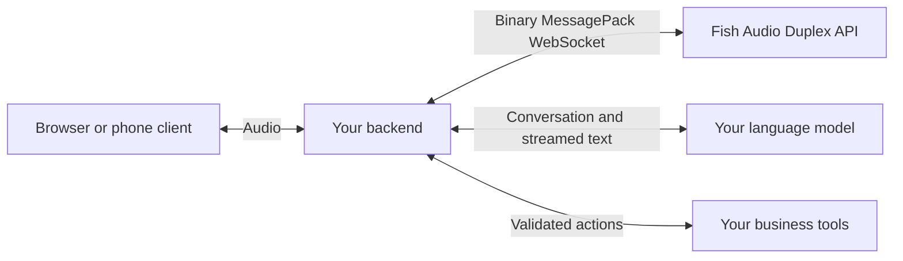

<Warning>
  **Preview — invitation only.** Access to the Fish Audio Duplex API is
  currently limited to selected customers. Public documentation and the starter
  repository do not grant service access.
</Warning>

The **Fish Audio Duplex API** provides the voice layer for an application you build and operate. You bring your own language model, conversation logic, and business tools. The API receives caller audio, detects conversational turns, generates speech from your model's text, and reports what was spoken when a caller interrupts.

Use it when you want direct control of your backend and voice interaction. For the managed product with agent configuration, deployment, and monitoring, see [Fish Audio Agents](/agents/overview).

## What you can build

Connect the API to your application's tools to support spoken workflows such as ordering, booking, or customer support. Your backend decides what actions are allowed and executes them in your systems.

| Capability               | How you use it                                                                       |
| ------------------------ | ------------------------------------------------------------------------------------ |
| Continuous audio         | Send microphone or call audio and receive generated speech on the same WebSocket.    |
| Eager turns              | Start preparing a response during a caller's pause, before their turn is committed.  |
| Interruptions            | Stop playback when the caller interrupts and continue from what they actually heard. |
| Your own model and tools | Stream text from your chosen LLM and keep tool execution in your backend.            |
| Voice selection          | Configure a supported voice reference for the session.                               |

The API is a voice protocol. Browser, WebRTC, or telephony connections to your application require the corresponding client or channel integration.

## Architecture

Open one server-to-server connection per call to `wss://api.fish.audio/v1/duplex/converse`. Keep your API key on the backend.



Fish handles the voice stream and turn events. Your backend supplies the conversation policy, sends text for speech, runs tools, and updates your application state.

## Try the voice-agent example

Before starting, you need an invitation to the Duplex API preview and enabled credentials. The example also requires Node.js 20 or later and Vertex AI credentials for its Gemini integration.

The [TypeScript voice-agent starter](https://github.com/fishaudio/duplex-api-starter) demonstrates a fictional diner with a browser microphone, live order display, and event inspector. It includes a server-side Duplex API connection, tools, interruption handling, and optional background ambience.

```bash
git clone https://github.com/fishaudio/duplex-api-starter.git
cd duplex-api-starter
cp config.example.toml config.toml
npm install
npm run dev
```

Fill in `config.toml` with your enabled Duplex API credentials and Vertex AI credentials path, then open `http://localhost:5173`. The setup dialog identifies missing configuration. Follow the repository's README for configuration and checks.

This is a reference application. Its menu, prices, and order state are sample data; confirming an order does not submit a real order or take payment. Production integrations need their own access controls, business systems, monitoring, and workflow testing.

## Handle a conversation

### 1. Start the session and audio clock

Send `session.start` immediately after connecting, as the first binary MessagePack frame, with `turns.eager: true`. Wait for `session.started` before streaming caller audio.

Send audio continuously in real time, including silence. The caller audio stream drives the session clock. For the framing, audio formats, and session fields, see the [Converse reference](/api-reference/endpoint/websocket/duplex-api-converse).

### 2. Prepare a response during a pause

On `turn.eager`, start your LLM request using the caller's provisional text. While that turn is still speculative, put `for: eager_id` on the first `reply.text` frame so Fish can prepare speech without playing it yet.

If `turn.committed` has already arrived before your first text token, omit `for` and send the reply normally. If the caller continues and `turn.resumed` arrives, cancel the speculative reply and stop using its result.

Eager generation overlaps model work with turn detection. It does not guarantee that a reply is ready at commit: model latency, tool calls, synthesis, network delivery, and playback buffering still contribute to the time the caller waits.

### 3. Execute tools at the right time

Read-only lookups may run during an eager turn. Hold actions that change state, such as adding an order or creating a booking, until `turn.committed` approves the matching `eager_id`.

When a tool needs time, send a short, relevant spoken bridge with `flush: true, last: false`. After the result, continue on the same `reply_id` and finish with `last: true`. Claim success only after the action succeeds.

### 4. Reconcile interruptions

Use the reported `reply.done.heard_text` in conversation history, and check `basis` to distinguish aligned from estimated progress. Preserve raw tool-call metadata required by your model provider across tool hops.

A committed turn marked `kind: "aside"` should not cancel an already committed reply. If an interruption is later classified as a dropped turn or aside, the application can resume the unspoken remainder on a new reply. The starter demonstrates this recovery path.

### 5. Finish after the farewell

When your application decides to end the call, wait for the farewell's `reply.done` and allow the playback buffer to drain before closing the connection. Closing immediately can cut off the final words.

## Measure the experience

Track model time to first token, turn commit to first audio, tool duration, and playback-buffer behavior separately. A model TTFT measurement is not the same as the time until a caller hears speech.

The browser example requests echo cancellation. Speakerphone results depend on the browser, operating system, and microphone/speaker setup; test the devices you plan to use.

## Protocol reference

<Card
  title="Duplex API Converse"
  icon="comments"
  href="/api-reference/endpoint/websocket/duplex-api-converse"
>
  Session fields, audio frames, turn events, and interruption receipts for
  `/v1/duplex/converse`.
</Card>
