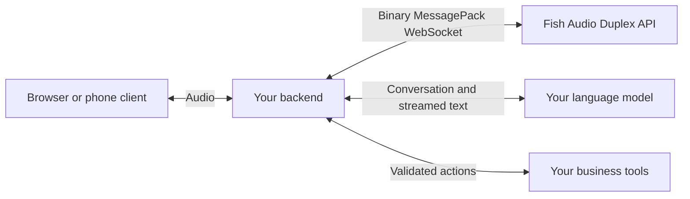
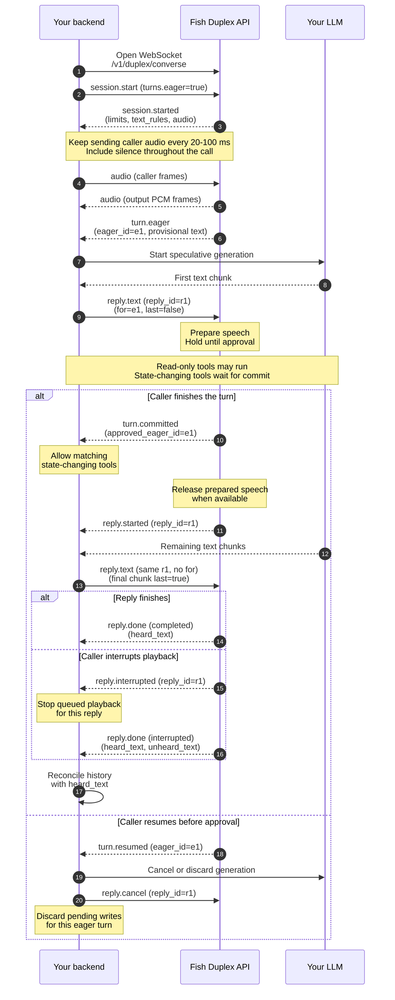

<Warning>
  **Preview — invitation only.** Access to the Fish Audio Duplex API is
  currently limited to selected customers. Public documentation and the starter
  repository do not grant service access.
</Warning>

The **Fish Audio Duplex API** provides the voice layer for an application you build and operate. You bring your own language model, conversation logic, and business tools. The API receives caller audio, detects conversational turns, generates speech from your model's text, and reports what was spoken when a caller interrupts.

Use it when you want direct control of your backend and voice interaction. For the managed product with agent configuration, deployment, and monitoring, see [Fish Audio Agents](/agents/overview).

## What you can build

Connect the API to your application's tools to support spoken workflows such as ordering, booking, or customer support. Your backend decides what actions are allowed and executes them in your systems.

| Capability               | How you use it                                                                       |
| ------------------------ | ------------------------------------------------------------------------------------ |
| Continuous audio         | Send microphone or call audio and receive generated speech on the same WebSocket.    |
| Eager turns              | Start preparing a response during a caller's pause, before their turn is committed.  |
| Interruptions            | Stop playback when the caller interrupts and continue from what they actually heard. |
| Your own model and tools | Stream text from your chosen LLM and keep tool execution in your backend.            |
| Voice selection          | Configure a supported voice reference for the session.                               |

The API is a voice protocol. Browser, WebRTC, or telephony connections to your application require the corresponding client or channel integration.

## Architecture

Open one server-to-server connection per call to `wss://api.fish.audio/v1/duplex/converse`. Keep your API key on the backend.

Authenticate the WebSocket upgrade with `Authorization: Bearer YOUR_FISH_API_KEY`. This header belongs to the connection request, not to a `session.start` frame.



Fish handles the voice stream and turn events. Your backend supplies the conversation policy, sends text for speech, runs tools, and updates your application state.

## Try the voice-agent example

Before starting, you need an invitation to the Duplex API preview and enabled credentials. The example also requires Node.js 20 or later and Vertex AI credentials for its Gemini integration.

The [TypeScript voice-agent starter](https://github.com/fishaudio/duplex-api-starter) demonstrates a fictional diner with a browser microphone, live order display, and event inspector. It includes a server-side Duplex API connection, tools, interruption handling, and optional background ambience.

```bash
git clone https://github.com/fishaudio/duplex-api-starter.git
cd duplex-api-starter
cp config.example.toml config.toml
npm install
npm run dev
```

Fill in `config.toml` with your enabled Duplex API credentials and Vertex AI credentials path, then open `http://localhost:5173`. The setup dialog identifies missing configuration. Follow the repository's README for configuration and checks.

This is a reference application. Its menu, prices, and order state are sample data; confirming an order does not submit a real order or take payment. Production integrations need their own access controls, business systems, monitoring, and workflow testing.

## Handle a conversation

The diagram shows an eager reply whose first text arrives before the caller's turn is committed. Caller audio keeps flowing throughout the exchange, including while the LLM and tools are working.



If `turn.committed` arrives before the first LLM token, omit `for` on the first `reply.text` frame. The numbered steps below cover this timing case and tool calls in more detail.

### 1. Start the session and audio clock

Send `session.start` once, immediately after connecting, as the first binary MessagePack frame, with `turns.eager: true`. The startup deadline is five seconds normally, or one second when server capacity is full. Wait for `session.started` before streaming caller audio.

For example, encode this object as MessagePack rather than sending it as a JSON text frame:

```json
{
  "type": "session.start",
  "audio": {
    "encoding": "pcm_s16le",
    "sample_rate": 24000
  },
  "turns": {
    "eager": true
  }
}
```

Omitting `voice` selects the server's default voice. To use a supported voice from the [Fish Voice Library](/features/manage-voices), add `"voice": {"reference_id": "YOUR_VOICE_REFERENCE_ID"}`. A voice may need preparation, so use `session.started` as the readiness signal.

Send audio continuously in real time in 20–100 ms chunks, including silence. The caller audio stream drives the session clock. Each WebSocket frame must contain one MessagePack map; `audio.data` is raw MessagePack binary, not base64 or an array of integers. For `pcm_s16le`, silence is zero-valued samples.

Only send supported session fields. In particular, `audio.noise_cancel` is not supported by the Duplex API and is rejected with `invalid_session_start` and close code `4400`. Browser microphone echo cancellation and noise suppression are configured in your client, separately from this handshake.

Read the negotiated input and output rates from `session.started.audio`, and configure playback using `output_sample_rate`. Use `session.started.limits` for the current message, text, held-reply, idle, and session limits. If you buffer speaker audio, set `playback.delay_ms` to reflect that delay so interruption alignment can account for it. See the [Converse reference](/api-reference/endpoint/websocket/duplex-api-converse) for all fields and supported audio formats.

#### Apply the session's spoken-text rules

Build the spoken portion of your LLM prompt from `session.started.text_rules`, because the voice model reads the supplied text aloud.

| Session field        | What your application should do                                                                                             |
| -------------------- | --------------------------------------------------------------------------------------------------------------------------- |
| `numbers: "spoken"`  | Write counts and codes as spoken words.                                                                                     |
| `numbers: "written"` | Keep numbers in written form where appropriate.                                                                             |
| `ack_in_t: false`    | Avoid opening every reply with acknowledgements such as "Okay" or "Sure"; the voice model supplies its own acknowledgement. |
| `avoid`              | Avoid the listed punctuation forms, such as colons, semicolons, or spaced dashes.                                           |

Keep ordinary replies brief and conversational. Do not send Markdown, HTML tags, URLs, or stage directions as speech. Tool schemas and structured arguments belong in your model/tool exchange, not in `reply.text`.

### 2. Prepare a response during a pause

On `turn.eager`, start your LLM request using the caller's provisional text. While that turn is still speculative, put `for: eager_id` on the first `reply.text` frame so Fish can prepare speech without playing it yet. Include `for` only on that first frame; keep the same `reply_id` as text continues, then send `last: true` when the reply is complete.

If `turn.committed` has already arrived before your first text token, omit `for` and send the reply normally. If the caller continues and `turn.resumed` arrives, cancel the speculative reply and stop using its result.

Eager generation overlaps model work with turn detection. It does not guarantee that a reply is ready at commit: model latency, tool calls, synthesis, network delivery, and playback buffering still contribute to the time the caller waits.

### 3. Execute tools at the right time

Read-only lookups may run during an eager turn. Hold actions that change state, such as adding an order or creating a booking, until `turn.committed` approves the matching `eager_id`.

When a tool needs time, send a short, relevant spoken bridge with `flush: true, last: false`. After the result, continue on the same `reply_id` and finish with `last: true`. Claim success only after the action succeeds.

The handoff is **LLM tool call → optional spoken bridge → tool execution → result back to the LLM → continued speech**. If the bridge is the reply's first frame and the turn is still speculative, include `for: eager_id` on it. If `turn.resumed` cancels the turn, discard its queued mutations instead of executing them later. Preserve provider-specific tool-call metadata, such as thought signatures, when sending tool results back to the LLM.

### 4. Reconcile interruptions

On `reply.interrupted`, stop playing queued audio from that reply. Use the final `reply.done.heard_text` in conversation history, and check `basis` to distinguish aligned from estimated progress. Do not record the unplayed `unheard_text` as something the caller heard.

A committed turn marked `kind: "aside"` should not cancel an already committed reply. If an interruption is later classified as a dropped turn or aside, the application can resume the unspoken remainder on a new `reply_id`. Include `unheard_text` plus any LLM text not yet sent to Fish, without repeating the heard prefix. The starter demonstrates this recovery path.

### 5. Finish after the farewell

When your application decides to end the call, wait for the farewell's `reply.done` and allow the playback buffer to drain before closing the connection. Closing immediately can cut off the final words.

## Connection errors and recovery

Handle an HTTP refusal during the WebSocket upgrade separately from a close after the connection opens. For a capacity-related `429`, honor `Retry-After` when supplied and retry with backoff and jitter.

| WebSocket close code | Meaning and next step                                                                                                        |
| -------------------- | ---------------------------------------------------------------------------------------------------------------------------- |
| `1000`               | Normal closure. End the local call cleanly.                                                                                  |
| `1002` / `4400`      | Protocol or message error. Check binary MessagePack framing, fields, types, and the initial `session.start` before retrying. |
| `1009`               | Message too large. Reduce frame sizes and respect the session limits.                                                        |
| `1012`               | Server restarting. Release the old connection and reconnect with backoff.                                                    |
| `4408`               | Startup or idle timeout. Check the startup sequence and continuous caller-audio clock.                                       |
| `4409`               | Client is not reading fast enough. Drain incoming events/audio and check for a blocked event loop.                           |
| `4413`               | Session limit reached. Finish local cleanup and start a new session when needed.                                             |
| `4429`               | Server busy. Retry with backoff.                                                                                             |
| `4500`               | Internal or ASR failure. End the affected session and apply your retry policy.                                               |

A reconnect creates a new session: send a fresh `session.start` and wait for its `session.started`. Clear playback queued from the old connection; do not replay old reply frames into the new one. Your application owns conversation and business state across connections.

## Measure the experience

Track model time to first token, turn commit to first audio, tool duration, and playback-buffer behavior separately. A model TTFT measurement is not the same as the time until a caller hears speech.

The browser example requests echo cancellation. Speakerphone results depend on the browser, operating system, and microphone/speaker setup; test the devices you plan to use.

For an ambience bed, the starter mixes it into outbound agent audio on the backend and lowers its volume while the agent speaks. Keep that playback mix separate from caller input so it does not become audio submitted for transcription.

## Protocol reference

<Card
  title="Duplex API Converse"
  icon="comments"
  href="/api-reference/endpoint/websocket/duplex-api-converse"
>
  Session fields, audio frames, turn events, and interruption receipts for
  `/v1/duplex/converse`.
</Card>
